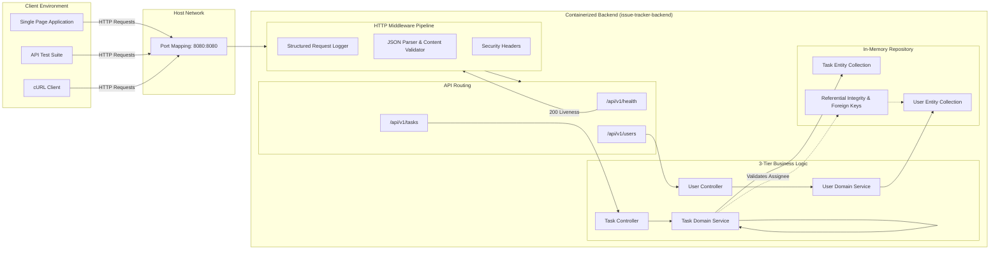

# Technical Specification & API Contract
## Issue & Sprint Task Tracking System

---

## 1. Domain Entities & Resources

The platform models two core business resources:
1. **Users (`User`)**: Team members who report, review, or are assigned tasks within project workflows.
2. **Tasks (`Task`)**: Work items (bugs, features, chores) with lifecycle states and assignee associations.

### Schemas

#### User Entity
| Field | Type | Required | Description | Example |
|---|---|---|---|---|
| `id` | `string` | Auto | Unique identifier | `"usr-201"` |
| `username` | `string` | Yes | Unique login handle | `"omid_dev"` |
| `fullName` | `string` | Yes | Full display name | `"Omid Reza Maghami"` |
| `email` | `string` | Yes | Unique corporate email address | `"omid@company.internal"` |
| `department` | `string` | Yes | Engineering department | `"Core Services"` |
| `role` | `string` | Yes | Role (`lead`, `engineer`, `qa`) | `"engineer"` |
| `createdAt` | `string` | Auto | ISO 8601 timestamp | `"2026-11-19T08:00:00.000Z"` |

#### Task Entity
| Field | Type | Required | Description | Example |
|---|---|---|---|---|
| `id` | `string` | Auto | Unique task identifier | `"TSK-101"` |
| `title` | `string` | Yes | Concise task summary | `"Optimize database connection pool"` |
| `description` | `string` | No | In-depth technical context | `"Reduce latency under peak load"` |
| `type` | `string` | Yes | Enum: `BUG`, `FEATURE`, `TASK`, `DOCS` | `"FEATURE"` |
| `status` | `string` | Yes | Enum: `BACKLOG`, `TODO`, `IN_PROGRESS`, `IN_REVIEW`, `DONE` | `"IN_PROGRESS"` |
| `priority` | `string` | Yes | Enum: `LOW`, `MEDIUM`, `HIGH`, `CRITICAL` | `"HIGH"` |
| `assigneeId` | `string` | No | Foreign key referencing `User.id` | `"usr-201"` |
| `estimatedHours` | `number` | No | Estimated effort in hours | `12` |
| `tags` | `array[string]` | No | Categorical tags | `["performance", "db"]` |
| `createdAt` | `string` | Auto | ISO 8601 timestamp | `"2026-11-19T08:30:00.000Z"` |
| `updatedAt` | `string` | Auto | Last modification timestamp | `"2026-11-19T09:15:00.000Z"` |

---

## 2. API Contract Specification

Base Endpoint: `http://localhost:8080/api/v1`

| # | Domain | Method | Route | Description | Success | Error Statuses |
|---|---|---|---|---|---|---|
| 1 | **Health** | `GET` | `/health` | Service uptime & liveness probe | `200 OK` | `500 Internal Error` |
| 2 | **Users** | `GET` | `/users` | List all users with optional filtering | `200 OK` | `500 Internal Error` |
| 3 | **Users** | `GET` | `/users/:id` | Fetch specific user by ID | `200 OK` | `404 Not Found` |
| 4 | **Users** | `POST` | `/users` | Create new team member | `201 Created` | `400 Bad Request`, `409 Conflict` |
| 5 | **Users** | `PUT` | `/users/:id` | Update profile information | `200 OK` | `400 Bad Request`, `404 Not Found` |
| 6 | **Users** | `DELETE` | `/users/:id` | Remove user & dissociate active tasks | `204 No Content` | `404 Not Found` |
| 7 | **Tasks** | `GET` | `/tasks` | Query tasks (filter by type, status, priority, assignee) | `200 OK` | `500 Internal Error` |
| 8 | **Tasks** | `GET` | `/tasks/:id` | Fetch single task details | `200 OK` | `404 Not Found` |
| 9 | **Tasks** | `POST` | `/tasks` | Create new task item | `201 Created` | `400 Bad Request`, `404 Not Found` (assignee) |
| 10 | **Tasks** | `PUT` | `/tasks/:id` | Comprehensive task update | `200 OK` | `400 Bad Request`, `404 Not Found` |
| 11 | **Tasks** | `PATCH` | `/tasks/:id/status` | Lifecycle status progression | `200 OK` | `400 Bad Request`, `404 Not Found` |
| 12 | **Tasks** | `DELETE` | `/tasks/:id` | Remove task item | `204 No Content` | `404 Not Found` |

---

## 3. Sample Payloads

### `POST /api/v1/users`
**Request:**
```json
{
  "username": "omid_lead",
  "fullName": "Omid Reza",
  "email": "omid.reza@company.internal",
  "department": "Platform Infrastructure",
  "role": "lead"
}
```
**Response (201 Created):**
```json
{
  "success": true,
  "data": {
    "id": "usr-1732000000001",
    "username": "omid_lead",
    "fullName": "Omid Reza",
    "email": "omid.reza@company.internal",
    "department": "Platform Infrastructure",
    "role": "lead",
    "createdAt": "2026-11-19T09:00:00.000Z"
  }
}
```

### `POST /api/v1/tasks`
**Request:**
```json
{
  "title": "Implement Redis Caching Layer",
  "description": "Cache frequent task queries to reduce repository lookups",
  "type": "FEATURE",
  "status": "TODO",
  "priority": "HIGH",
  "assigneeId": "usr-201",
  "estimatedHours": 8,
  "tags": ["redis", "backend", "cache"]
}
```
**Response (201 Created):**
```json
{
  "success": true,
  "data": {
    "id": "TSK-1732000000002",
    "title": "Implement Redis Caching Layer",
    "description": "Cache frequent task queries to reduce repository lookups",
    "type": "FEATURE",
    "status": "TODO",
    "priority": "HIGH",
    "assigneeId": "usr-201",
    "estimatedHours": 8,
    "tags": ["redis", "backend", "cache"],
    "createdAt": "2026-11-19T09:10:00.000Z",
    "updatedAt": "2026-11-19T09:10:00.000Z"
  }
}
```

---

## 4. System Architecture Diagram


