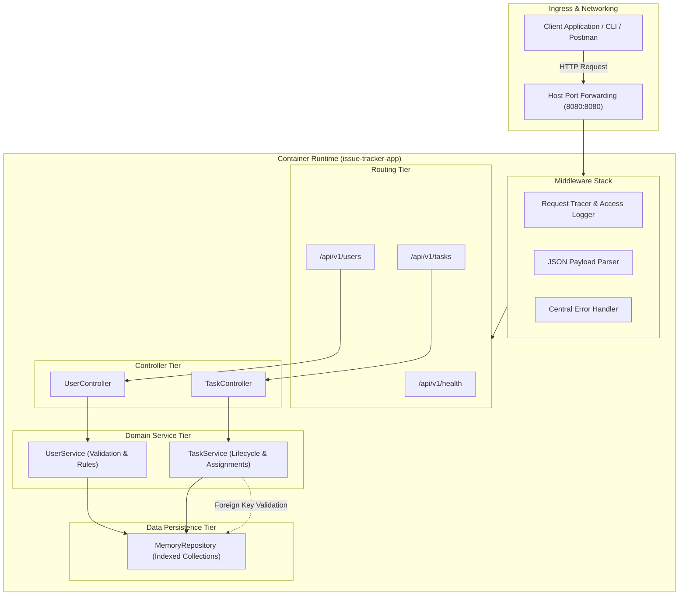

# Issue & Task Tracker API Service

> **Repository:** `maghamiomidreza6-source/my-project`  
> **Architecture:** 3-Tier Layered Architecture (Controllers -> Domain Services -> Repositories)  
> **Tech Stack:** Node.js, Express, Docker, RESTful APIs

A production-grade REST API engineered for issue tracking, agile task management, and team collaboration. Packaged with Docker containerization, tested with an automated integration suite, and designed with a formal API contract.

---

## Architecture Overview

The system is organized into a clean 3-tier architecture ensuring separation of concerns:



---

## API Specification

Base URL: `http://localhost:8080/api/v1`

### Endpoints Matrix

| # | Resource | HTTP Method | Endpoint | Description | Success Status | Error Codes |
|---|---|---|---|---|---|---|
| 1 | **System** | `GET` | `/health` | Liveness & uptime probe | `200 OK` | `500` |
| 2 | **Users** | `GET` | `/users` | List registered team members | `200 OK` | `500` |
| 3 | **Users** | `GET` | `/users/:id` | Get specific team member | `200 OK` | `404` |
| 4 | **Users** | `POST` | `/users` | Register a new user | `201 Created` | `400`, `409` |
| 5 | **Users** | `PUT` | `/users/:id` | Update profile information | `200 OK` | `400`, `404` |
| 6 | **Users** | `DELETE` | `/users/:id` | Remove user & dissociate assignments | `204 No Content` | `404` |
| 7 | **Tasks** | `GET` | `/tasks` | Query issues (filter by type, status, priority) | `200 OK` | `500` |
| 8 | **Tasks** | `GET` | `/tasks/:id` | Retrieve single task item | `200 OK` | `404` |
| 9 | **Tasks** | `POST` | `/tasks` | Create new work issue | `201 Created` | `400`, `404` |
| 10 | **Tasks** | `PUT` | `/tasks/:id` | Full issue update | `200 OK` | `400`, `404` |
| 11 | **Tasks** | `PATCH` | `/tasks/:id/status` | Advance issue status in lifecycle | `200 OK` | `400`, `404` |
| 12 | **Tasks** | `DELETE` | `/tasks/:id` | Delete issue | `204 No Content` | `404` |

> Comprehensive data models and sample JSON schemas are documented in [`API_CONTRACT.md`](./API_CONTRACT.md).

---

## Containerization & Port Mapping

### Container Features
- **Base Image:** `node:20-alpine` for minimal attack surface.
- **Security:** Execution as an unprivileged user (`USER node`).
- **Healthcheck:** Automatic container liveness validation on `/api/v1/health`.
- **Port Mapping:** Exposes internal port `8080` mapped to host port `8080`.

### Build & Run Commands

```bash
# 1. Build the Docker image
docker build -t issue-tracker-backend:latest .

# 2. Run the container with port mapping
docker run -d -p 8080:8080 --name issue-tracker-app issue-tracker-backend:latest

# 3. Check container status
docker ps

# 4. View container application logs
docker logs issue-tracker-app

# 5. Verify the endpoints via curl
curl http://localhost:8080/api/v1/health
curl http://localhost:8080/api/v1/users
curl http://localhost:8080/api/v1/tasks

# 6. Stop and clean up container
docker stop issue-tracker-app
docker rm issue-tracker-app
```

### Docker Compose
Run via Docker Compose:
```bash
docker compose up -d
```

---

## Git Workflow & Branching

The repository maintains an active Git Flow strategy:
- **`main`**: Verified, production-grade release branch.
- **`feature/issue-tracking-core`**: Feature branch containing isolated, modular atomic commits.
- **Commit Format:** Strict Conventional Commits standard (`feat:`, `docs:`, `ci:`, `chore:`).

---

## Local Development & Testing

### Installation

```bash
# Install dependencies
npm install

# Execute automated test suite (14 passing tests)
npm test

# Launch in development mode with hot reload
npm run dev

# Launch in production mode
npm start
```
